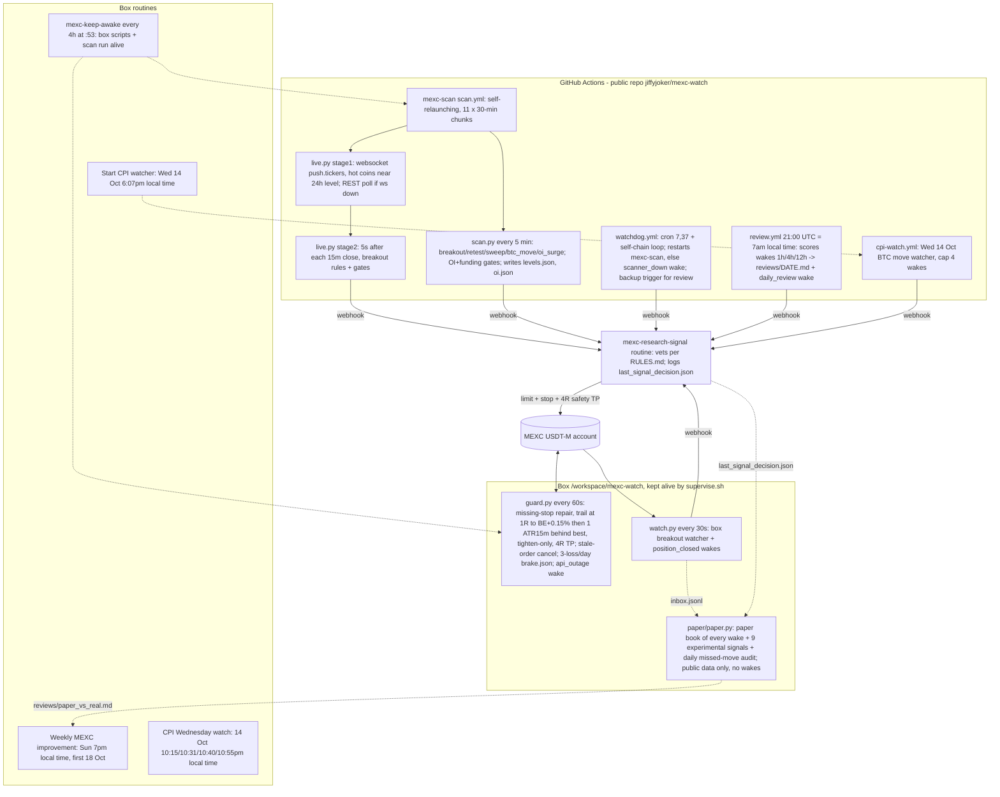

# MEXC desk — SYSTEM MAP (read first every session; update with every change)
Source of truth: box `/workspace/mexc-watch/SYSTEM_MAP.md` (copy in repo jiffyjoker/mexc-watch). Rules live in `RULES.md` — this file maps the system, it does not restate rules. Last verified against code: 2026-10-13 00:30 local time.

## 1. Flow

## 2. Components
| Component | Does | Lives | Health check | Restart |
|---|---|---|---|---|
| mexc-scan | 5-min REST signals + live websocket stage1/2 | repo `scan.yml`, `scan.py`, `live.py`, `common.py` | `gh run list -R jiffyjoker/mexc-watch -w mexc-scan -L 3` (one in_progress, newest step <45 min) | `gh workflow run mexc-scan -R jiffyjoker/mexc-watch` |
| watchdog | heartbeat, restart scan, `scanner_down` | `watchdog.yml`, `watchdog.py` | `gh run list -R jiffyjoker/mexc-watch -w watchdog -L 3` | `gh workflow run watchdog -R jiffyjoker/mexc-watch -f loop=true` |
| daily-review | score wakes, commit `reviews/` | `review.yml`, `review.py` | `ls /workspace/mexc-gh/reviews` after `git pull`; `gh run list -w daily-review -L 2 -R jiffyjoker/mexc-watch` | `gh workflow run daily-review -R jiffyjoker/mexc-watch` |
| cpi-watch | Wed CPI BTC watch (cron `50 11 14 10 *` UTC + dispatch) | `cpi-watch.yml`, `cpi_watch.py` | `gh run list -w cpi-watch -L 2 -R jiffyjoker/mexc-watch` | `gh workflow run cpi-watch -R jiffyjoker/mexc-watch` (test: `-f test=true`) |
| rate-test | ad-hoc probe runner | `rate-test.yml`, `bench.py`, `ws_probe.py` | n/a | dispatch only |
| guard.py | stops/trailing/brake/outage | box | `pgrep -af "python3 guard.py"`; `tail -5 /workspace/mexc-watch/guard.log`; `cat guard_state.json brake.json` | supervise.sh restarts within 60s |
| place.py (box) | ONLY way to enter: plan.py sizing, entry submitted with SL + 4R TP attached (order/submit), verifies stop, separate-stop fallback / cancel if unprotected | box | `python3 place.py SYM side --stop P --dry` | on demand |
| watch.py | box breakout + close alerts | box | `pgrep -af "python3 watch.py"`; `tail -5 watch.log` | supervise.sh |
| paper/paper.py | PAPER book (never trades: strips MEXC_* env, public GET only). Simulates every wake (box inbox.jsonl from watch.py hook: woke/prefilter/cap/brake skips; bot decisions from last_signal_decision.json) at live price, plan.py sizing, guard.py exits, taker 0.02%/side; plus 9 experimental paper-only signals (experiments.py + trend_signals.py: sr_bounce, v_reversal, vwap_cross, funding_fade, brk4h, momo, pullback20, btc_eth_dopen, orb_utc; top-50, 15m closes, background fetch ~51 req/15m, R-only sub-book). Files: paper/book.json, ledger.csv, open_positions.json, paper.log. 07:10 daily appends reviews/paper_vs_real.md (per-trade real action vs paper R, skip saved/cost, R per signal type vs backtest); 07:10 also spawns paper/missed.py -> reviews/missed_moves.md | box | `pgrep -af paper/paper.py`; `tail paper/paper.log`; `python3 paper/test_papersim.py`; `python3 paper/paper.py --report` | supervise.sh |
| supervise.sh | keeps guard+watch+lvb+paper alive | box | `pgrep -af supervise.sh`; `tail supervise.log` | `cd /workspace/mexc-watch && setsid nohup bash supervise.sh >/dev/null 2>&1 &` |
| Webhook secrets | WEBHOOK_URL / WEBHOOK_AUTH (repo secrets) = box env MEXC_RESEARCH_WEBHOOK_* | GitHub secrets / box env | `gh secret list -R jiffyjoker/mexc-watch` (names only — never print values) | `gh secret set` from env, no echo |
| Routines | research-signal, keep-awake, CPI watch, Start CPI watcher, Weekly improvement | Grok Bot routines | routine list | re-enable only if the owner asked |

State: repo actions/cache key `seen-<run_id>[-chunk]` holds seen.json, oi.json, wakes.json. Box: state.json (watch arming), guard_state.json, brake.json, trades.csv, last_signal_decision.json.

## 3. Rules (summary — details in RULES.md)
- Risk 5% of live equity at the stop; A+ up to 7%; 2.5% after 2 straight losses; pause after 4. Isolated 10x default, max 3 open, ≥ half the book free.
- Gates: side = day's direction; no-chase location measured at ARM time (close 2h before break: 0.50–0.85 long / 0.15–0.50 short) and ≤1% past level; breakouts/retests dropped if OI 6h < −1% or funding ≥ ±0.05% in trade direction.
- Exit: trailing stop default (BE+fees at 1R, then 1 ATR(15m) behind best, tighten-only), safety TP 4R. Nobody else moves a stop.

## 4. Decision log
| Date | Decision | Evidence |
|---|---|---|
| 2026-10-12 | Repo public (free unlimited Actions minutes) | — |
| 2026-10-12 | Self-relaunching workflow_dispatch loop instead of cron | GitHub schedule cron never fired |
| 2026-10-12 | OI history self-built from holdVol (oi.json) | 1h usable ~11pm 12 Oct, 6h ~3:30am 13 Oct |
| 2026-10-12 | Websocket two-stage scan (REST signals kept) | Live test caught XRP short breakout within seconds |
| 2026-10-12 | Arm-time location gate | Old check passed 9/129 breakouts (7d), arm-time 94/129, avg +0.21R vs +0.16R |
| 2026-10-12 | Rate limits OK | Back-to-back scans on GitHub runner, ~10× normal: 0 HTTP 429 in 1184 requests |
| 2026-10-12 | Kept 15m close trigger (not earlier triggers) | Early triggers caught more, made less per trade |
| 2026-10-12 | Trailing stop = default exit (the owner approved) | 14d/94 filtered trades: +16.1R vs +14.2R fixed, DD 10.8R vs 12.0R; built version +23.6R on 127; 4000 sim paths: never loosened |
| 2026-10-13 | Parallel paper book + 4 experimental paper-only signals (owner approved) | Replay 12 Oct 21:00–13 Oct 13:00: 28 wakes, paper +19.98R (23 wins), skips saved 5.07R / cost 24.49R (unconstrained: up to ~20 concurrent, ignores half-book/one-position). HYPE paper +0.56R vs real +0.45R. Experimental 21d backtest top-50: sr_bounce 1666 trades +0.042R avg, v_reversal 1071 +0.023R, vwap_cross 454 +0.040R, funding_fade 54 -0.113R |
| 2026-10-13 | Added paper signals brk4h (4h high/low break, chase<=1%, day side, arm-time location, vol>=3x), momo, pullback20; missed-move audit; Sunday auto-promotion rule in RULES (>=+0.15R avg over >=30 trades, DD ok; drop <0R) | 21d top-50 backtest: brk4h raw 2729 trades -0.030R, +chase -0.029R, +day/location +0.018R, +vol3x 410 trades (19.5/day) 49.5% win +0.134R net +55R DD 44.7R; momo 1505 +0.032R DD 180R; pullback20 1107 -0.046R. BTC 13:30-13:45 bar (close 83,178.9 > 4h high 83,071.9) caught by raw brk4h only; blocked by day-side/location (down day) |
| 2026-10-13 | 180d history check (top-50 today, 15m public klines 16 Apr–13 Oct, cache paper/cache/) + trend-day research. Added paper signals btc_eth_dopen (BTC/ETH 4h-break vol>=2x on the daily-open side) and orb_utc (10:00–10:30 AEST range break, vol>=1.5x) | 180d avg R (H1/H2): LIVE 24h breakout rules -0.041 (-0.113/+0.020) n=3471 net -141R DD 293R; brk4h+vol3 -0.065; momo -0.047; sr_bounce -0.042; v_reversal -0.040; btc_eth_dopen +0.016 (-0.004/+0.037) n=536 DD 36R; orb_utc +0.007 (-0.004/+0.018) n=2110; hl_cont -0.052; brk4h_dopen -0.067; brk4h_vreclaim -0.063; regime_brk4h -0.068. 21d edges were regime-specific. No live rule change; owner decides |
| 2026-10-12 | 6pm–7am entry window DEFERRED | +14.2R → +19.8R, but gains concentrated in last week; ask the owner Sun 18 Oct |

## 5. Open / pending
- Sun 18 Oct 7pm: re-run backtests with extra week; ask the owner on entry window.
- OI gate and oi_surge untestable until OI history accrues (started 12 Oct).
- live.py REST fallback (ws drop) never exercised live.
- Wed 14 Oct: Start CPI watcher 6:07pm, CPI watch routine 10:15pm+.
- HYPE short (opened 11:48pm 12 Oct) = first live trailing-stop trade; confirm guard TRAIL log at +1R.

## 6. Session start checklist
1. Read this file, then RULES.md.
2. `gh run list -R jiffyjoker/mexc-watch -L 8` — mexc-scan in_progress, watchdog recent, no failures.
3. `pgrep -af "guard.py|watch.py|supervise.sh"`; `tail -5 /workspace/mexc-watch/{guard,watch,supervise}.log`.
4. Open positions/stops: `cat guard_state.json brake.json`; verify on MEXC each position has a stop + TP.
5. `cat last_signal_decision.json`; latest `reviews/*.md`.
6. After any change: update RULES.md (if rule), this file (sections 2/4/5), and commit the repo copy.

## Paper book (2026-10-13)
- Never places orders: paper.py removes MEXC_* env vars at start and has no signed-request code. Box-only; nothing published.
- Main paper book compounds from the real equity at start, takes every wake regardless of caps (deliberately unconstrained so skips can be scored). Experimental signals live in a separate R-only list (fixed notional) and never wake the bot.
- Backups: watch.py.bak-20261013-paper, supervise.sh.bak-20261013-paper. Replay: `python3 paper/paper.py --replay 2026-10-12T21:00` -> paper/replay/.
- Missed-move audit: top-50 moves >=1.5% within 4h (last 24h) with no live/paper entry on that coin+direction from 1h before start to extreme; top 40 listed. First run 13 Oct 14:23: 388 moves, 383 'missed' (paper book only live since 13:20, so not meaningful yet).
- Research tools: paper/cache180.py (resumable 180d 15m cache, 0.3s pacing, ~450 req), paper/bt_trend.py (all candidates + live rules on the cache, H1/H2 split) -> paper/bt_trend.json. Caveat: universe = today's top 50 (survivorship), no OI/funding/taker gates, 15m-bar sim checks the stop first.
