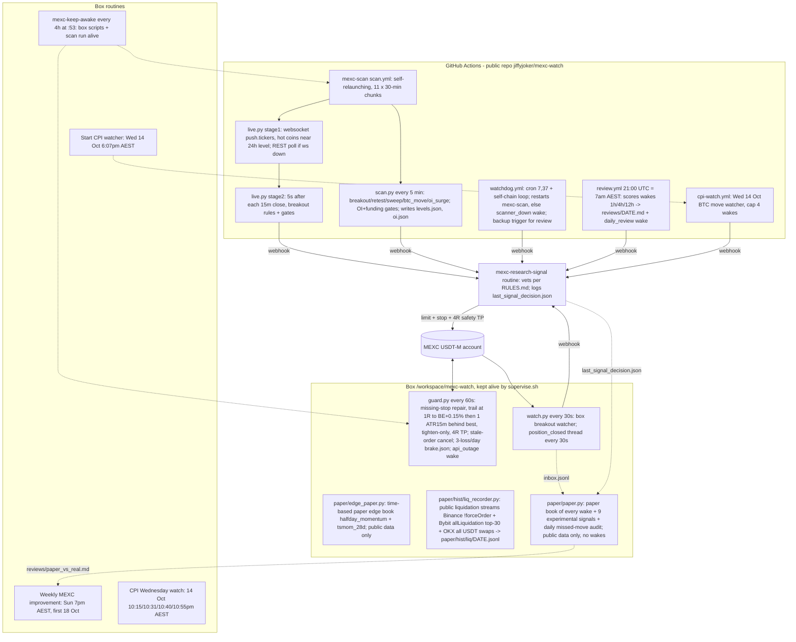

# MEXC desk — SYSTEM MAP (read first every session; update with every change)
Source of truth: box `/workspace/mexc-watch/SYSTEM_MAP.md` (copy in repo jiffyjoker/mexc-watch). Rules live in `RULES.md` — this file maps the system, it does not restate rules. Last verified against code: 2026-10-14 00:45 AEST.

## 1. Flow

## 2. Components
| Component | Does | Lives | Health check | Restart |
|---|---|---|---|---|
| mexc-scan | 5-min REST signals + live websocket stage1/2 | repo `scan.yml`, `scan.py`, `live.py`, `common.py` | `gh run list -R jiffyjoker/mexc-watch -w mexc-scan -L 3` (one in_progress, newest step <45 min) | `gh workflow run mexc-scan -R jiffyjoker/mexc-watch` |
| watchdog | heartbeat, restart scan, `scanner_down` | `watchdog.yml`, `watchdog.py` | `gh run list -R jiffyjoker/mexc-watch -w watchdog -L 3` | `gh workflow run watchdog -R jiffyjoker/mexc-watch -f loop=true` |
| daily-review | score wakes, commit `reviews/` | `review.yml`, `review.py` | `ls /workspace/mexc-gh/reviews` after `git pull`; `gh run list -w daily-review -L 2 -R jiffyjoker/mexc-watch` | `gh workflow run daily-review -R jiffyjoker/mexc-watch` |
| cpi-watch | Wed CPI BTC watch (cron `50 11 14 10 *` UTC + dispatch) | `cpi-watch.yml`, `cpi_watch.py` | `gh run list -w cpi-watch -L 2 -R jiffyjoker/mexc-watch` | `gh workflow run cpi-watch -R jiffyjoker/mexc-watch` (test: `-f test=true`) |
| rate-test | ad-hoc probe runner | `rate-test.yml`, `bench.py`, `ws_probe.py` | n/a | dispatch only |
| guard.py | stops/trailing/brake/outage | box | `pgrep -af "python3 guard.py"`; `tail -5 /workspace/mexc-watch/guard.log`; `cat guard_state.json brake.json` | supervise.sh restarts within 60s |
| place.py (+guard_api.py) | ONLY way to enter: plan.py sizing, entry submitted with SL + 4R TP attached (order/submit), verifies stop, separate-stop fallback / cancel if unprotected; `--dry` previews | box | `python3 place.py SYM side --stop P --dry` | run on demand by the signal routine |
| watch.py | box breakout + close alerts | box | `pgrep -af "python3 watch.py"`; `tail -5 watch.log` | supervise.sh |
| paper/paper.py | PAPER book (never trades: strips MEXC_* env, public GET only). Simulates every wake (box inbox.jsonl from watch.py hook: woke/prefilter/cap/brake skips; bot decisions from last_signal_decision.json) at live price, plan.py sizing, guard.py exits, taker 0.02%/side; plus 9 experimental paper-only signals (experiments.py + trend_signals.py: sr_bounce, v_reversal, vwap_cross, funding_fade, brk4h, momo, pullback20, btc_eth_dopen, orb_utc; top-50, 15m closes, background fetch ~51 req/15m, R-only sub-book). Files: paper/book.json, ledger.csv, open_positions.json, paper.log. 07:10 daily appends reviews/paper_vs_real.md (per-trade real action vs paper R, skip saved/cost, R per signal type vs backtest); 07:10 also spawns paper/missed.py -> reviews/missed_moves.md | box | `pgrep -af paper/paper.py`; `tail paper/paper.log`; `python3 paper/test_papersim.py`; `python3 paper/paper.py --report` | supervise.sh |
| paper/hist/liq_recorder.py | records public liquidations (Binance /market/ws/!forceOrder@arr = largest per symbol per second; Bybit allLiquidation top-30; OKX liquidation-orders WS :443) to paper/hist/liq/YYYY-MM-DD.jsonl (UTC day; ts,ex,sym,side=liquidated side,px,qty,usd). No keys | box | `pgrep -af liq_recorder`; `tail paper/hist/liq.log`; `wc -l paper/hist/liq/*.jsonl` | supervise.sh |
| paper/hist/ (history cache) | fetch_hist.py (resumable: fng, dvol, misc, coinbase, funding, vision) -> fear_greed.json, dvol_{BTC,ETH}_1h.json, stablecoins_total.json, fred/*.csv, yahoo_dxy_1d.json, coinbase_btcusd_1h.json + binance_btcusdt_spot_1h.json, funding/{binance,bybit}_SYM.json, vision_metrics/SYM/DATE.zip (5m OI, top-trader & global L/S, taker ratio). liq_heatmap.py SYM = estimated liquidation-cluster model from vision metrics | box | `ls paper/hist`; `cat paper/hist/fetch_*.log` | rerun `python3 paper/hist/fetch_hist.py <part>` (skips existing) |
| supervise.sh | keeps guard+watch+lvb+paper+edge_paper+liq_recorder alive | box | `pgrep -af supervise.sh`; `tail supervise.log` | `cd /workspace/mexc-watch && setsid nohup bash supervise.sh >/dev/null 2>&1 &` |
| Webhook secrets | WEBHOOK_URL / WEBHOOK_AUTH (repo secrets) = box env MEXC_RESEARCH_WEBHOOK_* | GitHub secrets / box env | `gh secret list -R jiffyjoker/mexc-watch` (names only — never print values) | `gh secret set` from env, no echo |
| Routines | research-signal, keep-awake, CPI watch, Start CPI watcher, Weekly improvement | Grok Bot routines | routine list | re-enable only if the owner asked |

State: repo actions/cache key `seen-<run_id>[-chunk]` holds seen.json, oi.json, wakes.json. Box: state.json (watch arming), guard_state.json, brake.json, trades.csv, last_signal_decision.json.

## 3. Rules (summary — details in RULES.md)
- Risk 5% of live equity at the stop; A+ up to 7%; 2.5% after 2 straight losses; pause after 4. Isolated 20x default (10x fallback if liq < 1.5x stop distance; plan.py), max 3 open, ≥ half the book free.
- Entries via place.py only: stop attached to the entry order (MEXC keeps SL/TP on the resting order, becomes a position stop on fill); guard still repairs/trails.
- Gates: side = day's direction; no-chase location measured at ARM time (close 2h before break: 0.50–0.85 long / 0.15–0.50 short) and ≤1% past level; breakouts/retests dropped if OI 6h < −1% or funding ≥ ±0.05% in trade direction.
- Exit: trailing stop default (BE+fees at 1R, then 1 ATR(15m) behind best, tighten-only), safety TP 4R. Nobody else moves a stop.

## 4. Decision log
| Date | Decision | Evidence |
|---|---|---|
| 2026-10-12 | Repo public (free unlimited Actions minutes) | — |
| 2026-10-12 | Self-relaunching workflow_dispatch loop instead of cron | GitHub schedule cron never fired |
| 2026-10-13 | Morning live-vs-bt: HYPE +0.45R trail exit 84.554; premature .lvb_last cleared; get() retries + loop ignores pre-0705 stamp |
| 2026-10-12 | OI history self-built from holdVol (oi.json) | 1h usable ~11pm 12 Oct, 6h ~3:30am 13 Oct |
| 2026-10-12 | Websocket two-stage scan (REST signals kept) | Live test caught XRP short breakout within seconds |
| 2026-10-12 | Arm-time location gate | Old check passed 9/129 breakouts (7d), arm-time 94/129, avg +0.21R vs +0.16R |
| 2026-10-12 | Rate limits OK | Back-to-back scans on GitHub runner, ~10× normal: 0 HTTP 429 in 1184 requests |
| 2026-10-12 | Kept 15m close trigger (not earlier triggers) | Early triggers caught more, made less per trade |
| 2026-10-12 | Trailing stop = default exit (the owner approved) | 14d/94 filtered trades: +16.1R vs +14.2R fixed, DD 10.8R vs 12.0R; built version +23.6R on 127; 4000 sim paths: never loosened |
| 2026-10-13 | 20x isolated default for new trades (the owner approved) | Halves margin per trade; MMR 0.23–0.5% → liq 4.5–4.8% away at 20x vs max 3% stop; guard drops to 10x if liq < 1.5x stop (HYPE at 3% stop) |
| 2026-10-13 | Parallel paper book + 4 experimental paper-only signals (owner approved) | Replay 12 Oct 21:00–13 Oct 13:00: 28 wakes, paper +19.98R (23 wins), skips saved 5.07R / cost 24.49R (unconstrained: up to ~20 concurrent, ignores half-book/one-position). HYPE paper +0.56R vs real +0.45R. Experimental 21d backtest top-50: sr_bounce 1666 trades +0.042R avg, v_reversal 1071 +0.023R, vwap_cross 454 +0.040R, funding_fade 54 -0.113R |
| 2026-10-13 | Added paper signals brk4h (4h high/low break, chase<=1%, day side, arm-time location, vol>=3x), momo, pullback20; missed-move audit; Sunday auto-promotion rule in RULES (>=+0.15R avg over >=30 trades, DD ok; drop <0R) | 21d top-50 backtest: brk4h raw 2729 trades -0.030R, +chase -0.029R, +day/location +0.018R, +vol3x 410 trades (19.5/day) 49.5% win +0.134R net +55R DD 44.7R; momo 1505 +0.032R DD 180R; pullback20 1107 -0.046R. BTC 13:30-13:45 bar (close 83,178.9 > 4h high 83,071.9) caught by raw brk4h only; blocked by day-side/location (down day) |
| 2026-10-13 | 180d history check (top-50 today, 15m public klines 16 Apr–13 Oct, cache paper/cache/) + trend-day research. Added paper signals btc_eth_dopen (BTC/ETH 4h-break vol>=2x on the daily-open side) and orb_utc (10:00–10:30 AEST range break, vol>=1.5x) | 180d avg R (H1/H2): LIVE 24h breakout rules -0.041 (-0.113/+0.020) n=3471 net -141R DD 293R; brk4h+vol3 -0.065; momo -0.047; sr_bounce -0.042; v_reversal -0.040; btc_eth_dopen +0.016 (-0.004/+0.037) n=536 DD 36R; orb_utc +0.007 (-0.004/+0.018) n=2110; hl_cont -0.052; brk4h_dopen -0.067; brk4h_vreclaim -0.063; regime_brk4h -0.068. 21d edges were regime-specific. No live rule change; owner decides |
| 2026-10-13 | 180d live-rules backtest (paper/bt_live.py -> bt_live.json; point-in-time top-30 by rolling 24h volume from cached top-50, range<7%, arm loc, chase<=1%, day side, vol3x, funding gate from public funding history, one position, wake cap 30; no OI/taker history public) | LIVE one-position: 290 trades (1.6/day), win 45%, avg -0.028R, net -8.0R, DD 36R; H1 -0.062 / H2 +0.010. Monthly: Apr -0.27, May +0.36, Jun -0.20, Jul -0.21, Aug -0.01, Sep -0.05, Oct +0.33. Variants (chosen on H1, checked on H2): US session 23:00-07:00 AEST +0.041/+0.042 (183 trades, DD 17R); BTC-direction -0.011/+0.066; chase 0.5% 0.000/+0.024. No live change; owner to decide Sunday |
| 2026-10-13 | Broad edge search, 365d 1h public data + funding (paper/cache1h, bt_edge.py -> bt_edge.json; params from literature, H1 select / H2 validate). Added paper-only edge_paper.py (halfday_momentum, tsmom_28d) under supervise.sh -> paper/edge_book.json | % of notional per position, taker: halfday_momentum_top50 (00-12 UTC sign -> hold 12-24 UTC) H1 +0.217% (t5.3) / H2 +0.138% (t3.4), 5/7 H2 months positive, maker +0.257/+0.178; tsmom_28d_hold1d H1 +0.035 (t0.6) / H2 +0.175 (t3.2). Failed: inverse live (H1 +0.007R, H2 -0.19R), tsmom 7d/7d, xs momentum 3w, xs 1d reversal, funding carry, BTC first-hour, Monday, weekend, BTC-lead/alt-lag, squeeze, z-score fade, weekly-open (sign flips H1/H2). Caveats: today's top-50 (survivorship), positions correlated (t overstated) |
| 2026-10-13 | watch.py position-close check moved to its own 30s thread (backup watch.py.bak-20261013-posthread) | AVAX closed 21:23, position_closed wake 21:37:14: old check ran every 5 min inside the main loop, which blocks for minutes on slow public calls at 15m closes. Sandbox test (stubbed API/webhook): close detected and woken in 25s |
| 2026-10-13 | Resting stop-entry (OCO) backtest, 12 months public 5m bars, point-in-time top-30 (paper/cache5m, bt_stopentry.py -> bt_stopentry.json): NOT adopted | One position at a time: close-confirmed live rules -0.067R (H1 -0.022 / H2 -0.108), 1.5/day, false-break 25%. H1-best stop entry stop_4h buf0.05% arm filters -> H2 -0.033 (fails). 24h buf0.25% arm US +0.024 overall (H1 -0.009/H2 +0.057), 24h buf0.05% none -0.001/-0.001. Stop entries false-break 28-49%. 4h levels worse than 24h. No variant passes H1->H2 |
| 2026-10-14 | Sentiment validation (paper/sentiment/, RESULTS.md): X analyst calls, X crowd score, funding extremes — NOT adopted, nothing added to paper | X full-archive search reaches 15 months (25/call); counts endpoint 7d only. 18 analysts, 494 keyword-labelled calls Apr–Oct: 3d directional +0.37% vs always-long +0.44% (no skill over drift); best MerlijnTrader n=36 +1.64% p=0.004 raw (~0.07 after 18-account correction). Crowd bull/bear score 41d: corr next-day -0.31 but halves flip (+1.04 / -0.46%/day). Funding extremes 365d (BTC pctl, market pctl, xs abs/pctl): all fail H2; xs 5% pctl 3d H1 +1.28% t4.8 -> H2 -0.84% t-3.8 |
| 2026-10-14 | AI/ML indicator scan + LightGBM cross-sectional test (paper/ml/bt_lgbm_xs.py -> ml/lgbm_result.txt): NOT adopted, nothing added to paper | Literature: zero-shot TSFMs (Chronos/TimesFM) ~50% direction on returns (arXiv 2511.18578); ML crypto XS papers profitable but alpha in small illiquid coins (SSRN 4295427); OFI/VPIN only seconds-horizon, unstable (SSRN 7227998). Test top-50 1h, 8h rebal, L/S 5/5, taker 0.02%/side + funding, 11 rank features: H1 in-sample +0.73%/8h t19.5 -> H2 OOS -0.20% t-4.2; monthly walk-forward -0.105% t-2.6 (2/9 months +). Single-feature baselines unstable H1/H2 (vol24 +0.05/+0.23 post-hoc only). Classic overfit; no robust edge |
| 2026-10-14 | Free history sources verified from box + liquidation recorder started under supervise.sh (backup supervise.sh.bak-20261014-liq) | No free liquidation HISTORY: Binance vision liquidationSnapshot 404 (discontinued), Binance REST allForceOrders gone, OKX REST liquidation-orders only last ~2h/100 rows, CoinGlass API paid (heatmap Professional $699/mo), Coinalyze needs API key, Hyblock heatmap $99/mo. Live streams work: Binance must use /market/ws/ path (plain /ws/ silent from box), OKX WS :8443 blocked but :443 works, Bybit OK. Multi-year free: vision metrics 5m from Dec 2021, DVOL 1h from Mar 2021, F&G daily from Feb 2018, Binance funding from Sep 2019, Bybit funding from 2020, Coinbase 1h, DefiLlama stablecoins from 2017, FRED. Heatmap reconstructable from vision OI (liq_heatmap.py POC) |
| 2026-10-14 | paper_vs_real real-R fix (paper.py backup paper.py.bak-20261014-realR; trades.csv backup .bak-20261014) | Bug: real R looked up by (coin, side) only, so 13 Oct AVAX short showed 5 Oct AVAX short's -1.21R. Now matched by time (live_vs_bt open +/-3h, else trades.csv close within 48h of paper open). trades.csv AVAX row corrected to R 0.75 (was 0.87, gross). Report line verified: real 0.75R |
| 2026-10-14 | Multi-year backtest, free Binance history (paper/hist/bt_multi.py -> bt_multi.json; 47 coins, 15m klines Dec 2021–Sep 2026, 5m metrics: 6 majors since Dec 2021, others ~400d; pre-registered params, H1/H2 + by year, taker 0.02%/side + Binance funding). Nothing new adopted | Live breakout rules, every signal taken: base +0.019R (t1.7); +OI6h gate +0.023; +taker gate +0.024; FULL live (OI+taker) +0.028R n11103 t2.3, H1 +0.021 / H2 +0.035 (t2.06), 2022 -0.015 = only strict PASS. Same rules ONE position at a time: -0.094R (H1 -0.087 / H2 -0.102), every year 2022–26 negative -> first-come one-position selection is what loses. DVOL below 1y median +0.042R (H2 t1.67 fail), above -0.015. oi_surge n103 +0.21R t1.25 (too few). Global L/S contrarian 24h +0.23% t2.55 but 2021/2026 negative (fail); top-trader L/S fail; taker-flow continuation -0.06% (t-5.8); heatmap magnet -0.01%, sweep-reverse -0.09% (t-3.5); F&G n59 noise; Coinbase premium +0.31% t1.58 fail. Caveat: today's top-50 universe (survivorship) |
| 2026-10-14 | Signal-SELECTION backtest (paper/hist/bt_select.py -> bt_select.json; live rules + OI6h + taker gates, 11,103 candidates Dec 2021–Sep 2026, small-account start compounding, MEXC contract sizes min 1 contract, 20x, margin <= half book; pre-registered N 1/2/3/5 x risk 5%/N or 2.5%, ranking first/volmult/oi6/location/dist, same-side cap 2, US session). No live change | CORRECTION to bt_multi 'one position -0.094R': its one_pos sorted same-bar ties by R (picked worst first) -> biased. Proper first-come N1 5%: +0.004R, 0.84/day, ruin (DD 98%). H1-best = N3, 1.67% each, rank by OI 6h rise: H1 +0.028R CAGR +13% DD 70% -> H2 +0.034R CAGR +35% DD 69%, all years + (2021 .10, 22 .013, 23 .03, 24 .008, 25 .019, 26 .087), 3.6 trades/day. N5 1% first: all-period DD 70%, H2 DD 52%. Every variant has DD >= 55% (best: N5 + same-side cap 2, 55%) -> edge ~+0.03R too thin for >=1% risk/trade. Min contract: <=1% rejected except 2.5% x N5 (margin cap). US-session: H1 +0.047 -> H2 +0.009 (fails) |
| 2026-10-12 | 6pm–7am entry window DEFERRED | +14.2R → +19.8R, but gains concentrated in last week; ask the owner Sun 18 Oct |

## 5. Open / pending
- Sun 18 Oct 7pm: re-run backtests with extra week; ask the owner on entry window.
- OI gate and oi_surge untestable until OI history accrues (started 12 Oct).
- live.py REST fallback (ws drop) never exercised live.
- Wed 14 Oct: Start CPI watcher 6:07pm, CPI watch routine 10:15pm+.
- HYPE short (opened 11:48pm 12 Oct) closed ~01:00 13 Oct at trailed stop ~84.54 (~+0.57R); first live trail confirmed (guard TRAIL at 00:49).

- Liquidation history accrues from 14 Oct 00:25 AEST (paper/hist/liq/); usable for cascade backtests after ~4 weeks. vision_metrics/klines/funding downloads complete 14 Oct ~02:45 AEST (curl xargs downloader paper/hist/dl1.sh; urllib threads stalled). Sunday: test portfolio selection (up to 3 concurrent / best-of-cluster) since all-signals +0.028R vs one-position -0.094R. Next: backtest OI/LS/taker gates, DVOL, F&G, Coinbase premium, heatmap clusters on cache.

## 6. Session start checklist
1. Read this file, then RULES.md.
2. `gh run list -R jiffyjoker/mexc-watch -L 8` — mexc-scan in_progress, watchdog recent, no failures.
3. `pgrep -af "guard.py|watch.py|supervise.sh"`; `tail -5 /workspace/mexc-watch/{guard,watch,supervise}.log`.
4. Open positions/stops: `cat guard_state.json brake.json`; verify on MEXC each position has a stop + TP.
5. `cat last_signal_decision.json`; latest `reviews/*.md`.
6. After any change: update RULES.md (if rule), this file (sections 2/4/5), and commit the repo copy.

## Wake prefilters (2026-10-13)
- Box: watch.py imports prefilter.py; before each breakout wake it checks vol>=3x, arm-time location, <1% past, day side, OI 6h (from state.json), funding, taker flow (public deals), and half-book (private assets, box only). Blocked -> `PREFILTER SKIP` in watch.log, coin marked fired (6h). Backup: watch.py.bak-20261013-pf.
- GitHub: common.taker_buy_share/taker_against used in scan.py and live.py before commit_hits; logs `skip taker`. Nothing private is published; no public 'book busy' flag (would leak trading activity, and GitHub wakes are rare compared with box wakes).

## Paper book (2026-10-13)
- Never places orders: paper.py removes MEXC_* env vars at start and has no signed-request code. Box-only; nothing published.
- Main paper book compounds from the live starting equity, takes every wake regardless of caps (deliberately unconstrained so skips can be scored). Experimental signals live in a separate R-only list (fixed notional) and never wake the bot.
- Backups: watch.py.bak-20261013-paper, supervise.sh.bak-20261013-paper. Replay: `python3 paper/paper.py --replay 2026-10-12T21:00` -> paper/replay/.
- Missed-move audit: top-50 moves >=1.5% within 4h (last 24h) with no live/paper entry on that coin+direction from 1h before start to extreme; top 40 listed. First run 13 Oct 14:23: 388 moves, 383 'missed' (paper book only live since 13:20, so not meaningful yet).
- Research tools: paper/cache180.py (resumable 180d 15m cache, 0.3s pacing, ~450 req), paper/bt_trend.py (all candidates + live rules on the cache, H1/H2 split) -> paper/bt_trend.json. Caveat: universe = today's top 50 (survivorship), no OI/funding/taker gates, 15m-bar sim checks the stop first.

## Sentiment research (2026-10-14)
- paper/sentiment/: collect.py (merges X search dumps -> raw/posts.jsonl, crowd files -> raw/crowd_*), score_calls.py (analyst calls vs MEXC 1h), crowd.py (daily crowd score vs next-day BTC), bt_funding.py (funding extremes, H1/H2). Results in RESULTS.md and *.json. Research only: no process, no wakes, no orders. raw/ holds public X post text; keep it box-only (not in repo).
